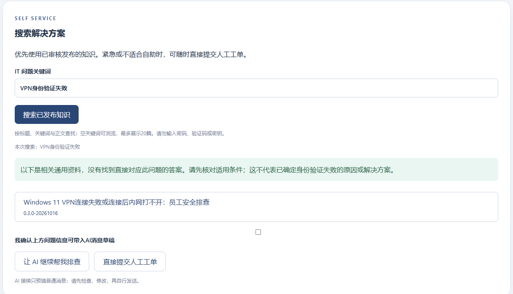
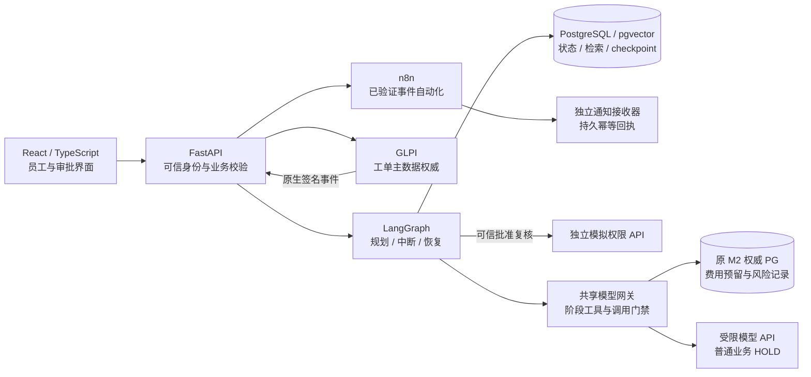

# ServiceOps AI — 企业 IT 服务台智能 Agent 与自动化工作流

以知识自助为入口、Agent 辅助诊断、人工工单兜底，重点验证**可信工具执行、ITSM 系统集成和故障恢复**。

这是使用合成身份的本地作品集：已有真实模型单例、真实隔离软件集成与真人审批证据；不代表企业生产部署或完整 M2 质量验收。

[知识自助与 Agent 诊断](docs/cases/trusted-agent-execution.md) · [GLPI 事件与 n8n 通知](docs/cases/n8n-enterprise-automation.md) · [人工审批与模拟执行](docs/cases/trusted-agent-execution.md#c人工决定恢复与模拟执行)

*真实产品截图，2026-10-21；已裁切。固定 Windows VPN 文章由人工审核，本图的相关匹配不是认证故障诊断结论。* [查看真实390px窄屏页面](docs/assets/portfolio/employee-knowledge-mobile.png)

## 三条业务路径

| 场景 | 员工做什么 | 已实现与证据入口 |
|---|---|---|
| **A：知识与诊断** | 搜索网络/VPN 问题；按需找 Agent，也可直接人工 | 员工目录已有1篇精确批准文章；另有真实 Qwen 单例完成规划→检索→建议→引用门禁。[可信 Agent 案例](docs/cases/trusted-agent-execution.md) |
| **B：工单事件自动化** | 提交办公软件故障，跟踪技术员处理结果 | GLPI 原生事件→FastAPI 验签/复核→PG→真实 n8n→独立持久通知回执。[n8n 案例](docs/cases/n8n-enterprise-automation.md) |
| **C：可信权限申请** | 申请 TEST 资源，等待授权人明确决定 | 真人浏览器批准→LangGraph 恢复→后端重读批准范围→独立模拟权限 API→F13。[审批案例](docs/cases/trusted-agent-execution.md#c人工决定恢复与模拟执行) |

搜索、反馈和 Agent 对话都不是提交人工工单的前提。模拟权限仅作用于独立 TEST 系统。

## 逻辑架构

**逻辑架构不代表所有场景曾在同一部署中完成统一端到端验收。** 模型不持有 GLPI 或模拟执行服务的凭据；n8n 不承担员工授权判断。

| 环境 | 用途与边界 |
|---|---|
| A 历史真实模型环境 | 2026-10-20固定单例；批次已关闭，费用记入原权威 PG；不能重领额度 |
| F13 演示副本 | 产品页面读取脱敏历史副本；不是再次执行模型，旧副本有有效期 |
| B/C 隔离环境 | 真实 GLPI、FastAPI、PG、n8n与独立模拟权限服务；合成人员与数据 |
| 独立知识库演示 | 员工/技师另有独立实例；18194后来接入同一精确文章，不等于 Agent 已使用其全文 |

## 三项核心工程能力

**可信 Agent。** 模型只提出阶段内工具意图，后端验证工具 Schema、参数、来源引用与用户权限。`provide_guidance`不是执行修复，`propose_ticket`不是建单。[设计与真实限制](docs/cases/trusted-agent-execution.md)

**企业系统自动化。** 使用 GLPI 原生签名事件和来源回查建立可信状态，再由 n8n 做有限字段处理和通知投递；通知效果以独立回执核验。[两段 HTTP 与真实故障](docs/cases/n8n-enterprise-automation.md)

**可靠性与安全。** PG持久状态、请求幂等、UNKNOWN保留风险、丢响应先查原回执、模型调用先预留后发送。展示失败轨迹，保留未解决问题；不宣称全链 Exactly Once。[40分钟学习路线](docs/learn/n8n-in-serviceops-40min.md)

## 实际验证等级

| 对象 | 实际等级 | 不能推导的结论 |
|---|---|---|
| A 真实 Qwen 单例 | **LIVE VERIFIED — LIMITED**；2 Chat + 1 Embedding，Usage估算¥0.0037772 | 不代表所有 Agent 回答或攻击场景通过；不是最终云结算 |
| B GLPI→n8n | **VERIFIED：真实隔离集成** | 本地接收器持久送达，不代表真实员工阅读 |
| C 人工批准正向闭环 | **VERIFIED：真人决定+真实隔离模拟执行** | 不是企业 IAM；所有负面状态未由真人重新验收 |
| F13 已覆盖产品追踪 | 已覆盖子项 **VERIFIED**；完整范围 **PARTIAL** | 历史副本、固定模型和真实执行必须区分 |
| M1 / M2 | M1 **CONDITIONAL**；M2 **PARTIAL / NOT VERIFIED / NOT ACCEPTED** | 历史正式任务只采集68/130轮，不能说完整130轮完成或通过 |

[脱敏证据卡](docs/assets/portfolio/evidence-summary.json)保留实际Usage、原件SHA与一致别名；[截图来源清单](docs/assets/portfolio/provenance.json)区分真实截图、遮挡与结构示意。原始日志和完整内部标识不随公开候选发布。

## 12–15分钟演示路线

1. **0–2分钟：员工入口。** 看上方真实知识页面：知识优先、Agent可选、随时人工；相关资料不是已确认解决方案。
2. **2–6分钟：真实 Agent 案例。** 对照 [A/C案例](docs/cases/trusted-agent-execution.md)：检索工具、Top3、引用门禁、3次Usage及历史失败。
3. **6–10分钟：n8n 自动化。** 看 [真实配置结构图与案例](docs/cases/n8n-enterprise-automation.md)，说明原生事件、生产Webhook、回执与丢响应恢复。
4. **10–13分钟：真人审批。** 看真实 approved 与 executed 截图、后端复核及模拟效果，不重新点击批准或恢复。
5. **13–15分钟：主动讲限制。** 真实与Mock证据边界、UNKNOWN风险、未通过的M2质量评估、生产与模拟的区别。

### 已有本地入口，不是互联网在线 Demo

| 入口 | 读取内容 | 本轮状态 |
|---|---|---|
| `http://127.0.0.1:18194/` | 主员工知识、工单、模拟申请；`/approval`为授权审批工作台 | 2026-10-21已验收；本轮未启动或重新验收在线服务 |
| `http://127.0.0.1:18193/` | F13历史记录隔离副本 | 旧副本约于2026-10-27到期；不得改到期时间冒充新运行 |
| `http://127.0.0.1:18281/`、`http://127.0.0.1:18282/_it/login` | 独立员工知识与技师入口 | 属于另一隔离环境；不混同主系统数据 |

2026-11-03核对时Docker Linux Engine不可达，因此本轮采用既有截图与原始记录。无需启动服务即可阅读这些案例；没有把旧页面说成现在仍在线。跨端口可能共享同名Cookie，观看私有演示环境时必须使用不同浏览器配置。

已有环境的启动须沿用所有者保留的私有配置与原交接，先只读核对容器、卷、到期状态和待办；本公开候选不提供默认自动启动。**不要重跑setup、prepare、provision、seed、index或evaluate，不导入并激活工作流，不消费已有待审批申请。** 普通MODEL LIVE与正式130轮保持HOLD，应用¥20/项目¥30边界不变。

## 个人职责与 AI Coding

项目所有者负责需求边界、技术选型、业务规则、风险与费用限制、工程决策和人工验收。Codex/AI Coding辅助实现、测试生成、调试与交付整理。这里不将全部源码宣称为个人独立手写，也不虚构企业客户协作经历。

面试可从两条取舍展开：为何复用GLPI而非重建ITSM；为何把模型意图、后端许可、实际效果和持久回执分开。再解释中断恢复为何不能携带批准权，以及故障为何必须保留UNKNOWN。

## 已知限制与阅读范围

- 非生产部署，采用分环境组合演示；没有企业客户规模、工时节约或生产容量证据。
- M2质量评估未通过；真实模型高风险覆盖有限，VPN受管/Always On/客户端适用性提醒仍不足。
- 模拟权限不是企业IAM；通知回执不等于员工已阅读；完整F13状态矩阵仍PARTIAL。
- 公开候选采用经筛选的源码阅读快照，未包含私有初始化资料、原Git历史、数据库或完整内部测试记录；不能一键重跑原工程。[源码与复现边界](SOURCE-SNAPSHOT.md)

[第三方归属与许可边界](THIRD-PARTY-NOTICES.md)。本项目自身的正式开源许可待所有者决定；没有自动套用MIT等许可。本轮没有创建远程仓库、push或发布Release。
