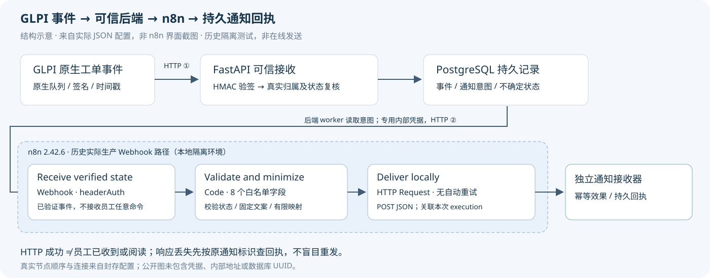

# 从 GLPI 工单事件到 n8n 通知：先信任来源，再确认效果

[返回首页](../../README.md) · [40分钟学习路线](../learn/n8n-in-serviceops-40min.md)

**验证等级：真实隔离GLPI / FastAPI / PostgreSQL / n8n / HTTP接收器，历史VERIFIED。** 本文整理已有工程原件，不重新发送事件；接收端是本地合成通知服务，不是企业聊天群或真实员工。

## 业务问题与设计

员工提交办公软件问题，技师在GLPI处理。需要通知员工状态变化，但不能把任意Webhook报文当成工单事实，也不能把一个HTTP200当作通知已送达。

*这是依据原工作流配置绘制的结构示意图，非n8n界面截图。本轮Docker不可达，未为截图启动n8n。节点名称、类型、顺序和连接均核对封存JSON；不补造UI或Execution画面。*

两段不同的HTTP边界：

| 边界 | 发送者→接收者 | 接收方必须证明什么 |
|---|---|---|
| **① 原生事件** | GLPI queuedwebhook→FastAPI内部入口 | 原生签名、时间窗口、Ticket/Entity合法；再向GLPI复核真实归属和状态 |
| **② 自动化触发** | 后端worker→n8n生产Webhook | 专用内部headerAuth；只接受已验证且持久登记的有限通知字段 |
| 后续投递 | n8n HTTP Request→独立接收器 | 原通知身份和内容一致，产生幂等效果与持久回执 |

GLPI是工单权威；FastAPI负责可信接收和业务判断；PG保存事件与意图；n8n负责有限自动化。后端签名通过后仍不信任Body里的Requester或权限声明。

## 原生合同如何核实

GLPI 11.0.11实际发送合同是`X-GLPI-signature = HMAC-SHA256(raw JSON body + decimal X-GLPI-timestamp, shared secret)`，中间无分隔符。依据是该版本源码及受控原生发送记录，不是照通用Webhook教程猜测。

时间戳和签名在**入队**时生成，重试不刷新。FastAPI验证4096字节上限、JSON类型、单一签名/时间头、过去600秒/未来30秒窗口、重复JSON键和字段白名单。员工入口不暴露内部接收路由。

验签只证明报文来源。后端还要从已完成Operation确定员工，向GLPI回查Requester、Entity、当前状态和`date_mod`。先持久接收事实，才确认接收；不能拿Payload宣称的用户当可信身份。

## 真实三个 n8n 节点

历史固定版本为**n8n 2.42.6**。源码导出`active=false`，历史运行导出`active=true`；两者含义不同。实际使用`/webhook/serviceops-ticket-state`，测试路径不等于已发布路径。官方对两种URL的说明见[Webhook文档](https://docs.n8n.io/integrations/builtin/core-nodes/n8n-nodes-base.webhook)。

| 实际名称 / 类型 | 输入与配置 | 输出与边界 |
|---|---|---|
| `Receive verified state` / `n8n-nodes-base.webhook` v2 | POST、headerAuth、`responseMode=lastNode` | 触发真实Execution；认证不等于完成员工授权 |
| `Validate and minimize` / `n8n-nodes-base.code` v2 | `$input.first().json.body`；仅8个字段 | 校验整数ID、受绑定来源、状态/版本时间格式及固定文案；不运行用户命令 |
| `Deliver locally` / `n8n-nodes-base.httpRequest` v4.2 | POST JSON、独立headerAuth、`jsonBody={{ $json }}`、1000ms超时 | 用`={{ $execution.id }}`关联执行；`retryOnFail=false`，不盲目重试 |

8个字段为`notice_id/source_id/ticket_id/entity_id/recipient_id/status/revision/message`。例如状态4映射为`pending`，文案严格为`Ticket #13: pending. Local TEST notification.`；Code节点只处理后端已验证数据，不重新判断谁有工单权限。

可阅读[脱敏未激活模板](../../workflows/ticket-state.public-template.json)：节点和连接来自实际配置，但删除了原Credential ID、替换了实例标识和接收地址。它不是原始执行导出，也不应直接激活；需要另行安全配置和授权。HTTP节点概念参考[官方HTTP Request文档](https://docs.n8n.io/integrations/builtin/core-nodes/n8n-nodes-base.httpRequest)。

## 一条可追溯的真实链

选取合成工单**#13**的自动状态通知。以下别名一致地关联原件，完整数据库UUID仅由所有者在私有映射中保留。

| 阶段 | 公开别名与可核事实 |
|---|---|
| GLPI | 工单#13，可信Requester为员工A，Entity回查通过，持久状态pending；来源revision为`2026-10-20T14:15:17+00:00` |
| 原生队列 | `B-QUEUE`；记录的签名epoch为`1792505714`，原生签名核验通过，发送1次，接收HTTP202 |
| 可信事件 | `B-EVENT`；原生正文SHA与持久事件SHA一致 |
| 通知意图 | `B-NOTICE`；绑定同工单、员工和来源revision，先入PG再投递 |
| n8n | `B-EXECUTION`；真实原生Execution为success，经过上述3节点 |
| 持久效果 | `B-RECEIPT`；独立接收端outcome=delivered，后端acknowledged，尝试1次 |

这条链没有手工代调用队列或dispatch。签名时间与工单来源revision是不同字段，不用跨组件时间先后替代状态复核。原始正文SHA为`4b1fd4a709892fabe859b57b6a0a2e76618960353e036dbf3c93b4866c66ff38`；逐项脱敏证据见[证据卡B](../assets/portfolio/evidence-summary.json)。

## 失败、恢复与隐私

| 历史真实隔离检查 | 实际结果 |
|---|---|
| 重复原生事件 | 持久指纹/同来源快照合并，不重复产生通知效果 |
| 乱序与重新打开 | 新快照不被旧事件回退；5→2重开合法，不能按状态数字单调排序；同秒歧义保持待核 |
| PG不可用与重启 | 未持久接收不确认；恢复后原生重投保持幂等和持久连续 |
| n8n暂不可用 | 保留意图及delivery_unknown；先查接收端，确认可安全投递后恢复 |
| 接收器已提交、响应丢失 | `B-LOST-RESPONSE`：n8n真实超时error，后端delivery_unknown；GET原回执后acknowledged，attempts仍1，无第二次POST |

**Execution失败不等于副作用未发生。** 回执有原通知UUID、完整内容SHA和可信来源关联；接收端具有持久幂等保证，后端才有依据在必要时安全恢复。采用至少一次传输配合幂等效果，不宣称全链Exactly Once。delivered只表示本地接收器持久化，不代表员工收到或阅读。

早期真实测试发现n8n执行存储曾保留认证Header。之后采用固定原生源码摘要绑定的入口投影：**原生headerAuth之后、执行数据保存之前**只保留字段白名单，并撤销早期合成密钥、私有保存失败原件。不是“关闭保存选项就天然不落凭据”。公开版本不含这些原始执行输入或认证引用。

## 源码阅读与未验证范围

阅读[可信事件实现](../../backend/ticket_events.py)、[接收器](../../backend/notification_receiver.py)、[真实归属适配器](../../backend/adapter.py)。公开候选是阅读快照，[复现边界](../../SOURCE-SNAPSHOT.md)说明未包含的初始化和原始数据。

本案例证明本地真实软件通知链及所列故障恢复。没有向真实企业渠道发送，未证明员工阅读、生产容量或完整分布式事务；事件指纹会合并同秒相同有限报文，不能替代全量ITSM审计。
