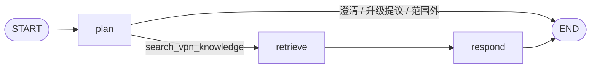
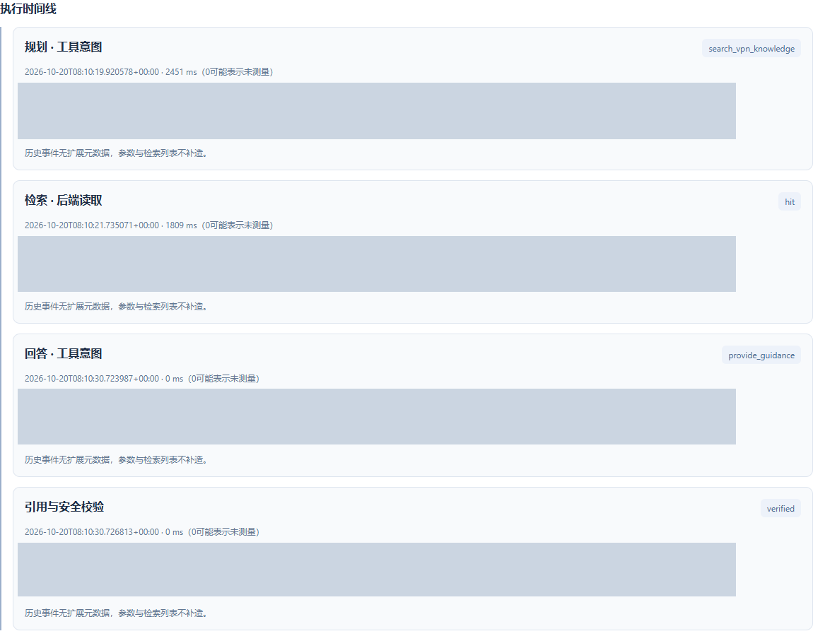
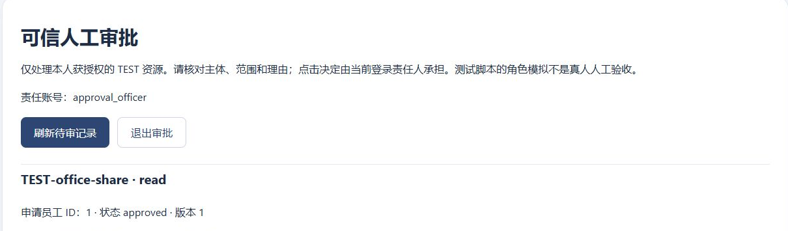
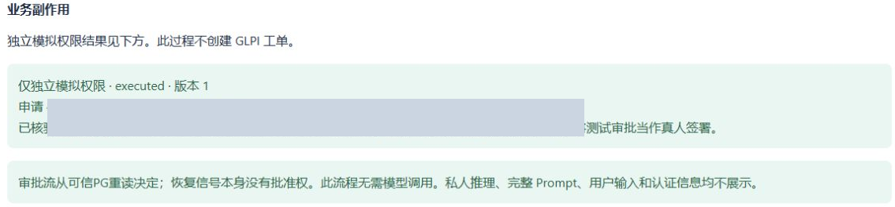

# 可信 Agent 执行：把模型意图、许可与业务效果分开

[返回首页](../../README.md) · [自动化案例](n8n-enterprise-automation.md)

这不是一次“全部测试通过”的故事。A保留真实模型有限成功和历史工具失败；C以真人决定验证审批恢复。模型不会因为生成一个函数名就获得写权限。

## A：真实 Qwen 工具意图与证据门禁

**问题。** 固定样本`M2-base-network-07`：`Windows 11 刚换 Wi-Fi 后无 Internet，VPN 连接超时。` 需要先区分基础网络和VPN，不能凭超时断言服务器或密码故障，也不能臆造企业配置。

**设计。** LangGraph注册`plan/retrieve/respond`三个节点，回答后再做`guidance_gate`后端校验（门禁是事件，不是额外注册Graph节点）。规划与回答各有自己的工具白名单；工具参数Schema不接受用户身份、任意URL或自由命令。

**真实轨迹。** 2026-10-20、执行源码`354c17941c5d44a84ad27ad650df1ee58e09c7fb`，只运行这一例：

| 阶段 | 模型意图或后端工作 | 原件证据 |
|---|---|---|
| plan | Qwen选择`search_vpn_knowledge`，查询基础网络/换Wi-Fi/VPN超时 | `A-PLAN`；真实函数响应 |
| retrieve | text-embedding-v4查询向量；1024维；pgvector真实Top3 | `A-EMBED`；已存在12个RAG块，没有重新索引 |
| respond | Qwen选择`provide_guidance`，引用实际检索资料 | `A-ANSWER`；3个实际chunk进入回答上下文 |
| guidance_gate | 验证Schema、参数、chunk_id、原文短引、配置/危险操作及虚构执行声明 | verified事件；不是模型自报通过 |

Top3为微软基础网络资料1块、Windows内置VPN资料2块。原始标题、URL、版本和相似度见[证据卡A](../assets/portfolio/evidence-summary.json)。不是把一个chunk当完整操作手册，也不是检索了员工知识目录中那篇完整批准文章。

*封存真实产品截图，展示历史真实记录隔离副本；原浏览器记录未登记截图时刻，不补造精确拍摄时间。已裁切并遮挡内部关联ID，节点结果未改；不是本轮再次调用模型，也不是完整F13验收。*

### 费用与副作用

| 真实请求 | Usage输入/输出Token | 调用前最大预留 | Usage费用估算 |
|---|---:|---:|---:|
| `A-PLAN` / Qwen Chat | 1264 / 43 | ¥0.8027918 | ¥0.0011273 |
| `A-EMBED` / Embedding | 22 / 0 | ¥0.0040960 | ¥0.0000110 |
| `A-ANSWER` / Qwen Chat | 1709 / 471 | ¥0.8027918 | ¥0.0026389 |
| 合计 | 2995 / 514 | ¥1.6096796授权上界 | **¥0.0037772** |

真实HTTP总计3次，无重试、新UNKNOWN或GLPI写入。预留和Usage估算通过原M2权威PG处理；最大预留不是实际收费。供应商最终逐笔结算仍未证明，成功响应没有保留可用于最终逐笔对账的供应商Request ID。已关闭批次不能重新领取授权；本轮新增模型请求为0。

没有GLPI写入，是因为这一诊断路径没有调用确认接口，也没有给隔离执行器业务写凭据。不是因为模型已经“安全地修复了网络”。工单另需当前摘要版本与员工明确确认。

### 为什么仍是 LIMITED

此前真实同例遇到`tool_not_allowed`。旧脱敏记录没有保留足够工具名/参数，不能可靠还原为某一个模型或解析器根因；后续阶段工具说明及`tool_choice`兼容性有离线修复证据，不能回写旧失败为成功。

新轨迹确实完成检索和建议，但受管VPN、Always On及第三方客户端适用性提醒不足。引用原文存在只证明来源关联，不保证建议获得企业操作许可或业务语义充分。改进候选仅离线验证，未修改这次真实输出或冒称真实效果已改善。

历史20条提示注入、10条明确确认、2条响应丢失恢复主要有固定模型/受控集成证据，不能提升为完整真实Qwen端到端覆盖。M2质量评估仍未验收。

## C：人工决定、恢复与模拟执行

**问题。** 模型或客户端可以说“已经批准”，但不能据此授予权限。恢复进程也不能把`Command(resume=...)`携带的数据当作授权。

**设计。** [access_graph](../../backend/access_graph.py)使用真实PostgresSaver和`interrupt()`暂停；人类在可信工作台决定。PG保存责任身份、请求版本、范围SHA与截止时间；恢复只唤醒Graph，执行前重新读取可信决定。[access_service](../../backend/access_service.py)与[独立模拟API](../../backend/permission_simulator.py)再次约束本人不可自批、角色/资源、版本、范围、未过期及未撤销。

*原始人类操作后的真实截图；角色是合成TEST审批角色。本文没有新建批准记录、签名或再次点击决定。*

**证据。** 原件有2条真实人类浏览器批准，仅恢复选定的`C-REQUEST`：`TEST-office-share / read / version 1`。申请人与审批者身份不同；后端读取`C-DECISION`，向独立模拟服务提交可信意图，得到`C-GRANT`的持久回执。最终phase=executed、attempts=1、checkpoint next=[]；重复恢复不重复产生效果，另一条已批准申请没有被执行。

*真实历史业务回读，裁切及灰色标识遮挡；executed状态和安全提示未改。不是企业真实权限授予，也不代表本轮再次操作。*

F13关联审批等待、真实决定、恢复请求、执行意图、模拟核验和恢复结果，区别意图与实际回执。未批准、越权、改版本、过期、撤销、丢响应及未知结果等负面路径另有受控角色/TEST PG/MockTransport证据，不把它们描述为全由真人重新完成的验收。老申请已过有效期，不修改历史期限来做新演示。

## 谁负责信任什么

| 组件 | 职责 | 不能自行决定 |
|---|---|---|
| 模型 | 提出澄清、检索、建议或工单摘要意图 | 用户身份、批准、业务执行成功 |
| LangGraph | 节点路由、持久状态、中断/恢复 | 把resume载荷当批准 |
| FastAPI/可信服务 | Session身份、Schema、引用、确认、来源归属与批准范围复核 | 信任请求Body或模型自报权限 |
| GLPI | 工单、Requester/Entity、技师处理和公开回复权威 | 替代权限审批权威 |
| 独立模拟权限API | 再核授权范围，按原UUID幂等执行并持久回执 | 访问真实企业IAM或接受模型口头批准 |
| 原权威费用PG | 原子费用预留、已知Usage估算、UNKNOWN及风险记录 | 把未知Usage改成0或视作供应商结算成功 |

源码继续阅读：[Agent Graph](../../backend/agent_graph.py)、[工具门禁](../../backend/tools.py)、[RAG检索](../../backend/knowledge.py)、[模型网关](../../backend/model_gateway.py)、[Trace投影](../../backend/agent_trace.py)。当前阅读源码是后续提交快照，不能与历史执行Git静默混同；公开副本的[源码边界](../../SOURCE-SNAPSHOT.md)另列。
