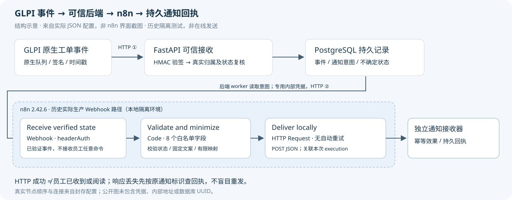

# 用40分钟读懂 ServiceOps 的 n8n 自动化

[返回首页](../../README.md) · [完整工程案例](../cases/n8n-enterprise-automation.md)

目标：能解释本项目三个节点处理什么、一次Execution能证明什么，以及超时后为什么先查回执。只读学习既有配置和脱敏记录，不搭新平台、不执行Webhook或重放工单。

## 0–8分钟：建立五个概念

| 概念 | 本项目里的实际对象 |
|---|---|
| Trigger | `Receive verified state`的Webhook；收到合法内部POST才开始工作流 |
| Node | 一个处理步骤：Webhook、Code、HTTP Request |
| Workflow | 三个节点及连接、认证配置、执行设置组成的流程 |
| Execution | 工作流的一次实际运行；同一工作流可以有多次成功或失败运行 |
| 数据映射 | 从上游JSON挑有限字段生成下游请求；不是让模型自由生成命令 |

先用两分钟看[结构示意图](../assets/portfolio/n8n-workflow.svg)。图严格来自实际JSON，不是n8n UI截图。再用三分钟在[脱敏模板](../../workflows/ticket-state.public-template.json)找到nodes、connections、active、settings。

官方说明区分[Test/Production Webhook](https://docs.n8n.io/integrations/builtin/core-nodes/n8n-nodes-base.webhook)：本项目历史实际入口是`/webhook/serviceops-ticket-state`。`/webhook-test/`用于测试监听；不要把复制一个测试URL当作激活了正式路径。这里“production URL”是n8n的路由名称，不等于企业生产部署。

**第8分钟自检：** 工作流JSON里的active=false与历史真实运行的active=true能同时成立吗？可以：前者是未激活源码导出，后者来自实际运行原件；不能只看导出猜运行状态。

## 8–20分钟：沿着三个节点读数据

### 8–12分钟：Webhook接收

找到`Receive verified state`：POST、headerAuth、最后节点响应。发送者是可信后端worker，**不是GLPI直接发到n8n**。GLPI先到FastAPI验原生HMAC、检查真实工单归属并持久接收；之后才有n8n这一段。

接收的有限字段是notice_id、source_id、ticket_id、entity_id、recipient_id、status、revision、message。n8n的headerAuth证明调用者掌握内部凭据，并不能独立证明员工拥有工单权限。

### 12–16分钟：Code校验与映射

在`Validate and minimize`里找`$input.first().json.body`。代码核对8个字段、整数ID、固定来源、状态和revision格式，再以固定模板形成文案。例如状态4对应pending，工单13的文案是`Ticket #13: pending. Local TEST notification.`。

`return [{json: ...}]`把结果作为下一节点输入。它不是数据库授权，也不保存完整工单正文。公开模板中的来源标识已替换，仅供阅读，不可当原始已签名报文重发。

### 16–20分钟：HTTP Request投递

`Deliver locally`是[真实HTTP Request节点](https://docs.n8n.io/integrations/builtin/core-nodes/n8n-nodes-base.httpRequest)：POST、独立headerAuth、JSON请求体`={{ $json }}`。`={{ $execution.id }}`帮助接收端关联本次运行，不能单独充当业务幂等键。

超时1000ms、retryOnFail=false。接收端要按原通知UUID/内容SHA做持久幂等，并回查可信来源；n8n不能任意更换接收员工或状态。模板地址为保留示例域名，原凭据ID已删除；**不要导入激活或发送请求来“验证学习”**。

## 20–30分钟：用真实成功与失败排障

读取[证据卡B](../assets/portfolio/evidence-summary.json)，依次定位：

1. `B-QUEUE`的正文SHA与签名时间，`B-EVENT`相同SHA。
2. `B-NOTICE`的可信工单、recipient和revision关联。
3. `B-EXECUTION`的success与`B-RECEIPT`的delivered。
4. `B-LOST-RESPONSE`的delivery_unknown→acknowledged，尝试次数仍1。

| 观察到什么 | 可以得出的结论 | 下一步只读检查 |
|---|---|---|
| FastAPI确认持久接收 | 事件事实已入PG | 是否已来源复核、排队；不是员工已收到 |
| n8n Execution success | 本次节点链按返回结果完成 | 独立接收器是否有可信持久回执 |
| HTTP Request超时/error | 客户端没得到确定响应 | 不能断定未送达；先按原通知ID查回执 |
| delivery_unknown | 后端保留不确定状态 | 核对原UUID、内容SHA、来源版本，不换新ID盲发 |
| 有合法持久回执 | 可确认本地接收器效果 | 仍不是人类阅读确认 |

真实丢响应例中，接收器先提交，后因延迟导致n8n超时。后端只GET原回执即确认，attempts没有变为2。若接收端没有可靠幂等/回执，则不能凭“再试一次应该没事”恢复。重复事件、乱序、合法重开及n8n停机的历史结果见[案例故障表](../cases/n8n-enterprise-automation.md#失败恢复与隐私)。

另一个真实教训：早期执行存储曾落入认证Header。隐私防护需要验证保存前的数据边界；不能以“UI没有显示密钥”或“关闭成功执行保存”推断数据库不含秘密。本公开材料没有原始认证输入。

## 30–40分钟：解释n8n与Agent的分工

用前五分钟画出两段HTTP：GLPI→FastAPI、可信后端→n8n。后五分钟口头回答：

- n8n不判断员工是否有工单权限；Session、Requester/Entity回查在可信后端。
- n8n不替代GLPI；工单状态及技师处理仍以原生ITSM为准。
- n8n不负责LangGraph规划；模型工具意图与Graph的中断恢复是另一条编排链。
- n8n处理已验证事件的自动化和通知投递；副作用可信性仍需来源复核、持久状态与回执。

### 五道理解题与参考答案

1. **GLPI签名正确，能直接按Payload中的员工发通知吗？** 不能。签名证明来源，不证明当前Requester/Entity及员工归属；后端须回查。
2. **导出active=false，证明历史没运行吗？** 不能。需要实际运行导出和Execution原件；源码导出可以刻意保持未激活。
3. **HTTP节点超时，可换新notice_id再发吗？** 不能。原操作可能已生效，先查同一通知的持久回执。
4. **两次Execution是否必然产生两次通知效果？** 不必然。传输可能至少一次，接收端按可信ID/内容做持久幂等；不等于全链Exactly Once。
5. **把n8n节点改成AI Agent能获得审批权吗？** 不能。人类决定必须保存并由可信服务重读；模型或编排工具不能自行批准。

完成后应能在两分钟内讲清“来源认证、业务授权、工作流执行、持久通知效果”四件不同的事。此学习不要求重启服务、创建工单或调用任何模型。

官方概念页面核验日期为2026-11-03；本项目历史参数与行为以封存的2.42.6配置及原始记录为准，不将当前文档里的所有功能追溯为历史已用。
